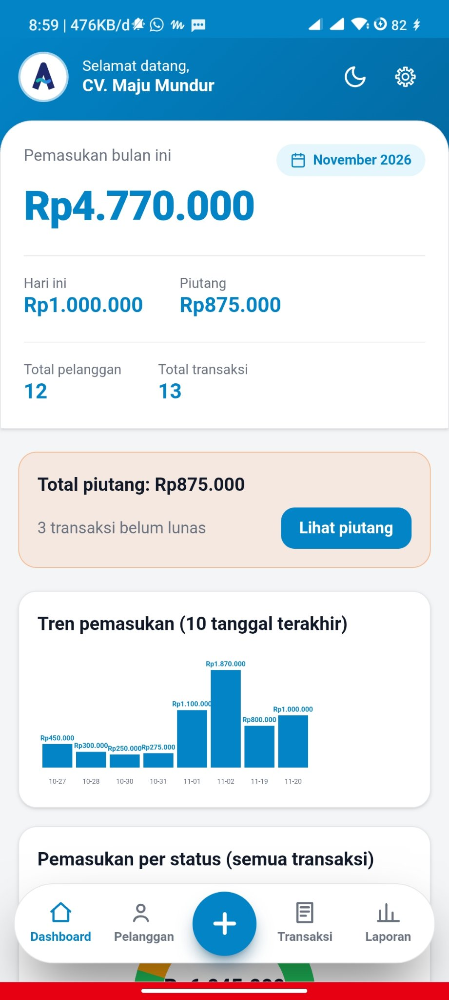
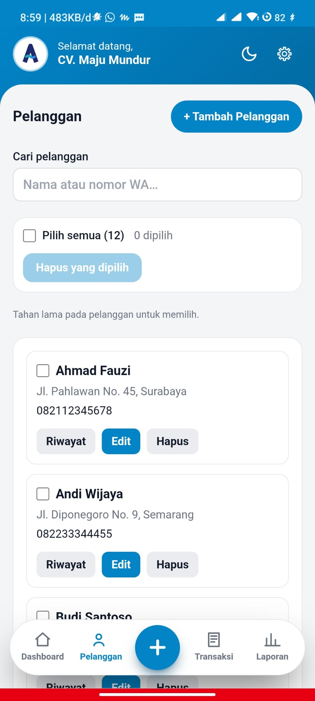
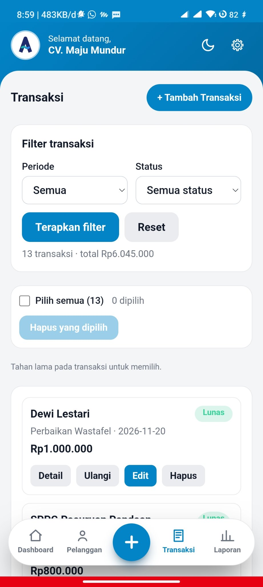
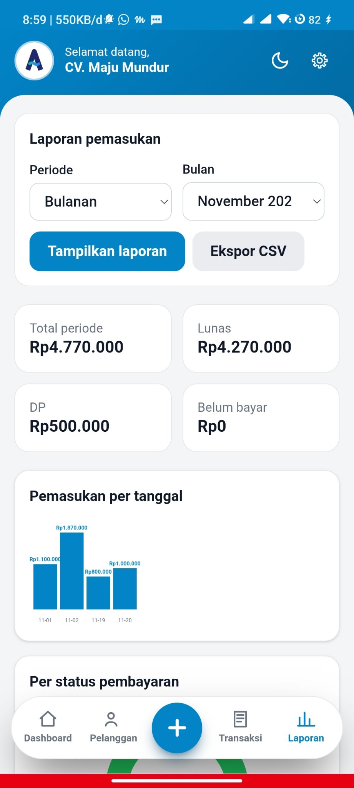
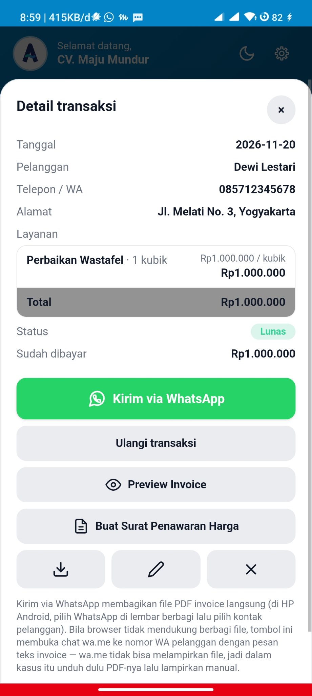
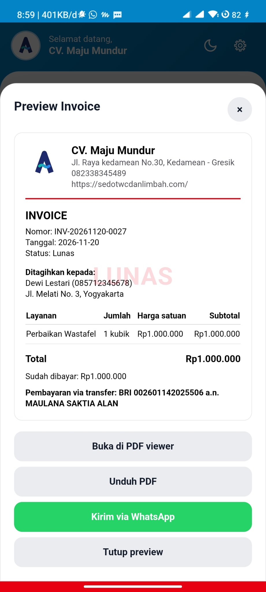

# Pencatat Pelanggan Jasa

Webapp pribadi untuk mencatat pelanggan jasa dan laporan pemasukan harian sampai bulanan. Dibuat untuk pemakaian sendiri (satu akun), tanpa server/VPS sendiri.

**Stack:** Cloudflare Pages (frontend Next.js + Tailwind CSS, static export) + Pages Functions (API) + D1 (database SQLite Cloudflare). Semua gratis di paket gratis Cloudflare untuk pemakaian pribadi — Workers 100.000 request/hari, D1 5 juta baris dibaca/hari, 100.000 baris ditulis/hari, storage 5 GB.

## Fitur

- Login satu akun (lihat bagian Login di bawah)
- Data pelanggan: nama, alamat, nomor telepon/WA, cari berdasarkan nama/WA
- Transaksi jasa: pelanggan, jenis jasa, nominal (Rp), tanggal, status (lunas / DP / belum bayar), catatan
- Dashboard: pemasukan hari ini, bulan ini, jumlah pelanggan, transaksi terbaru, grafik tren pemasukan dan donat per status
- Laporan: harian, bulanan, atau rentang tanggal — total, per status, per jenis jasa, detail transaksi, grafik batang per tanggal, donat per status, dan batang per jenis jasa
- Navigasi bawah melayang dengan tombol + di tengah untuk tambah transaksi baru
- Hapus massal: centang beberapa pelanggan/transaksi lalu hapus sekaligus (hapus pelanggan juga menghapus transaksinya)
- Invoice PDF: buka detail transaksi di tab Transaksi, lalu unduh invoice PDF (header memakai informasi usaha dari Pengaturan)
- Multi-layanan per transaksi: satu transaksi bisa berisi beberapa baris layanan (cth: Sedot WC + Perbaikan Wastafel + Lain-lain) dalam satu invoice; tiap baris punya jumlah, satuan (kubik/strip/pcs/paket/tanki/titik), harga satuan, dan subtotal — total transaksi adalah jumlah subtotalnya. Laporan per jenis jasa juga dihitung per baris layanan, bukan per transaksi.
- Pengaturan: tema gelap/terang dan informasi usaha (nama, alamat, telepon, website) yang dipakai di invoice
- Skema warna: pilih Biru, Merah, Hijau, Oren, Putih, atau Full Hitam di Pengaturan — satu garis shade yang sama untuk semua skema, tetap kalem
- Logo perusahaan: upload di Pengaturan (otomatis diperkecil maks. 512px, disimpan di D1), tampil di kop invoice di kiri nama usaha
- Logo aplikasi: logo dokumen+grafik+pena hitam-merah, versi dark (latar hitam) dan light (latar putih) di header dan login; tombol profil di pojok memakai logo perusahaan bila sudah diupload, bila belum memakai ikon profil
- Kirim invoice ke WhatsApp: dari detail transaksi, tombol Kirim via WhatsApp membagikan file PDF langsung lewat lembar berbagi perangkat (Web Share API, Chrome Android — pilih WhatsApp lalu pilih kontak pelanggan). Bila browser tidak mendukung berbagi file, fallback-nya membuka chat wa.me ke nomor WA pelanggan dengan pesan teks invoice (wa.me tidak bisa melampirkan file)
- PWA: manifest + service worker (shell bisa dibuka offline, API tidak pernah di-cache), menu Install aplikasi ada di Profil & Pengaturan saat browser menawarkan instalasi
- Ekspor laporan ke CSV

## Tampilan Aplikasi

Tampilan aplikasi di HP (mode terang), November 2026:

| | | |
|---|---|---|
| <br>**Dashboard** — pemasukan bulan ini, piutang, tren | <br>**Pelanggan** — daftar & cari pelanggan | <br>**Transaksi** — filter periode & status |
| <br>**Laporan** — filter periode, total per status | <br>**Detail transaksi** — kirim WA, preview invoice | <br>**Preview Invoice** — invoice siap kirim |

## Login: password lama + Google OAuth (multi-tenant)

Ada dua cara masuk, dan data tiap usaha terpisah total (tabel `businesses`
+ kolom `business_id` di pelanggan, transaksi, dan daftar harga):

1. **Google OAuth — pendaftaran terbuka.** Siapa pun dengan akun Google bisa
   daftar lewat tombol "Login dengan Google", lalu membuat profil usahanya
   sendiri. Setiap pemilik hanya melihat usahanya (maksimal 5 usaha per akun).
2. **Password lama (satu akun admin).** Login ini mengakses usaha legacy —
   data yang sudah ada sebelum multi-tenant. Dari menu profil, akun password
   bisa "Hubungkan akun Google" supaya usaha legacy itu pindah ke akun
   Google-nya.

Di Dashboard Pages project ini, buka **Settings > Functions > Environment variables**, lalu set:

| Nama | Jenis | Isi |
|---|---|---|
| `ADMIN_USERNAME` | Variable | Username login, misal `andro` |
| `ADMIN_PASSWORD_HASH` | Secret (terenkripsi) | SHA-256 hex dari password |
| `SESSION_SECRET` | Secret (terenkripsi) | String acak untuk menandatangani cookie sesi |
| `GOOGLE_CLIENT_ID` | Variable | Client ID dari Google Cloud (OAuth 2.0) |
| `GOOGLE_CLIENT_SECRET` | Secret (terenkripsi) | Client secret dari Google Cloud |

Google OAuth (sekali saja, di [Google Cloud Console](https://console.cloud.google.com/)):
buat project, aktifkan **OAuth consent screen** (User type External, scope
`openid email profile` — scope non-sensitif, tanpa verifikasi), lalu
**APIs & Services > Credentials > Create OAuth client ID** (tipe Web
application). Authorized redirect URI harus persis:
`https://laporan.androwee.com/api/auth/google/callback`
(dan `http://localhost:8787/api/auth/google/callback` bila dites lokal).
Karena pendaftarannya terbuka untuk siapa pun, ubah aplikasi OAuth ke
**Production** di consent screen — kalau masih Testing, hanya test user yang
bisa login dan tokennya kedaluwarsa 7 hari.

Sesi berlaku 7 hari lewat cookie HttpOnly. Kalau env belum di-set, halaman login akan menampilkan pesan "Login belum dikonfigurasi" — itu sengaja, bukan bug.

## Deploy (sekali saja)

### 1. Buat database D1

Di Dashboard Cloudflare: **Workers & Pages > D1 > Create**, nama `pencatat-laporan`. Lalu jalankan skema:

```bash
npx wrangler d1 execute pencatat-laporan --file=migrations/schema.sql
```

Alternatif tanpa CLI: tempel isi `migrations/schema.sql` di konsol D1 di dashboard.

### 2. Buat Pages project

**Workers & Pages > Create > Pages > Connect to Git**, pilih repo ini, lalu:

- Framework preset: Next.js
- Build command: `npm install && npm run build`
- Build output directory: `out`

### 3. Binding D1

Di Pages project: **Settings > Functions > D1 database bindings**, tambah binding:

- Variable name: `DB`
- D1 database: `pencatat-laporan`

### 4. Set env login

Seperti tabel di atas, lalu **Retry deployment** (atau deploy ulang) agar env baru aktif.

### 5. Coba

Buka URL Pages project, login dengan username/password yang tadi dibuat, lalu:

1. Tambah 1 pelanggan di tab Pelanggan
2. Tambah 1 transaksi di tab Transaksi
3. Cek tab Dashboard dan Laporan — angkanya harus berubah

## Pengembangan lokal (opsional)

```bash
npm install
npm run dev        # frontend Next.js saja (API /api/* butuh Pages Functions yang jalan di Cloudflare)
npm run build      # static export ke out/, dicek sebelum push ke main
```

## Backup

Data pelanggan adalah data pribadi. Ekspor CSV dari tab Laporan secara berkala, dan simpan salinannya di tempat aman. Jangan jadikan repo ini publik: repo harus tetap **private**.

## Struktur

```
src/app/                Frontend Next.js + Tailwind (tema hitam-merah)
  page.js               Satu halaman: login, dashboard, pelanggan, transaksi, laporan
  globals.css           Tema dan gaya dasar
src/components/Charts.js  Grafik SVG (batang, donat, batang horizontal)
public/_headers         Header keamanan untuk Pages
functions/api/          Pages Functions, satu file per endpoint
  login.js logout.js me.js customers.js customers/[id].js
  jobs.js jobs/[id].js reports.js export.js
shared/api.js           Seluruh logika API + auth env + query D1 (dipakai semua endpoint)
migrations/schema.sql   Tabel customers dan jobs
wrangler.toml           Konfigurasi Pages (binding D1 di-set lewat dashboard)
```
